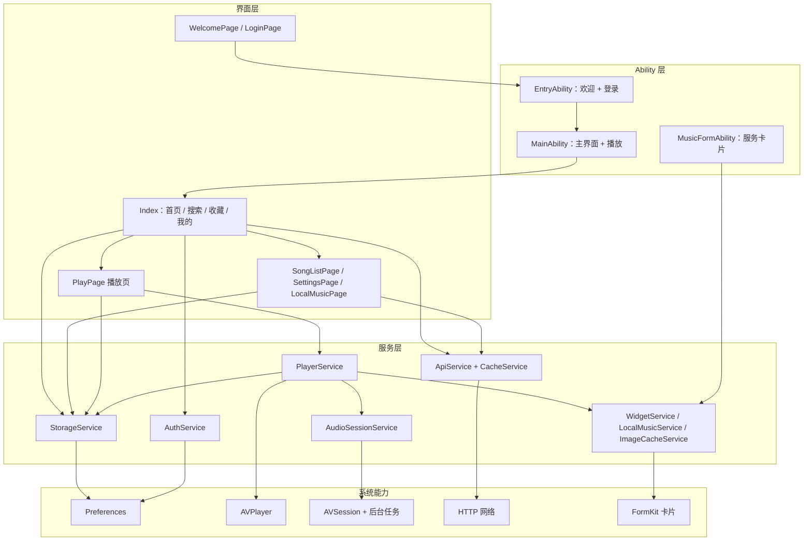
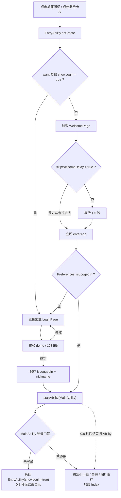
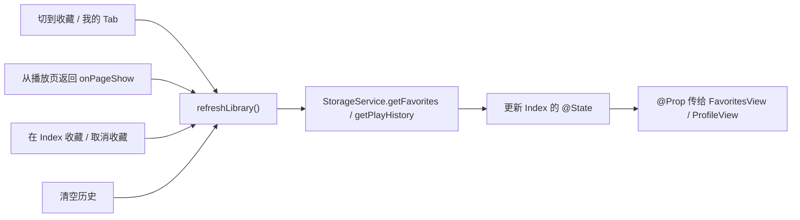
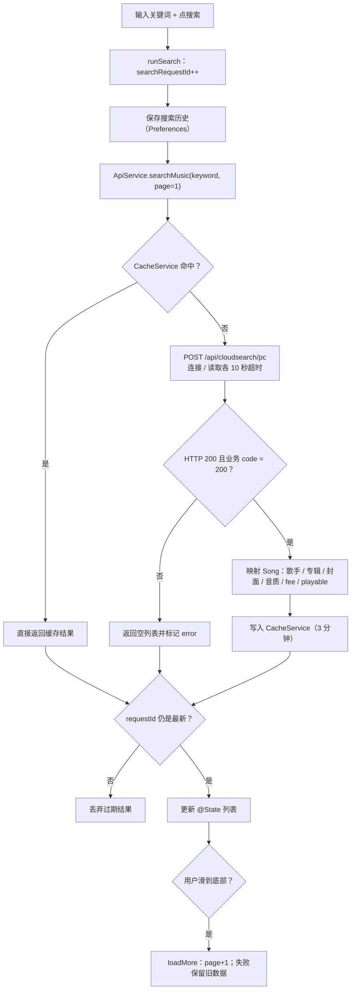
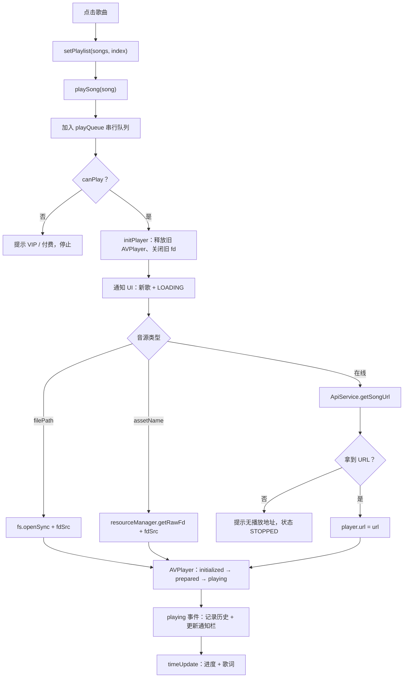
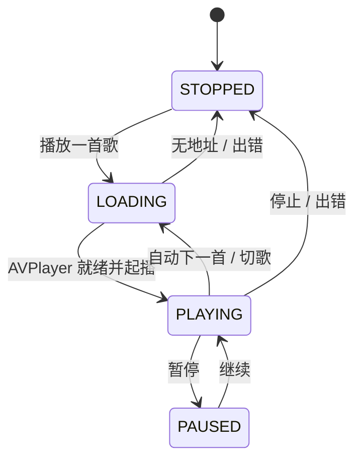
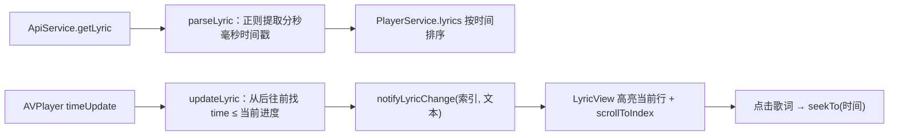
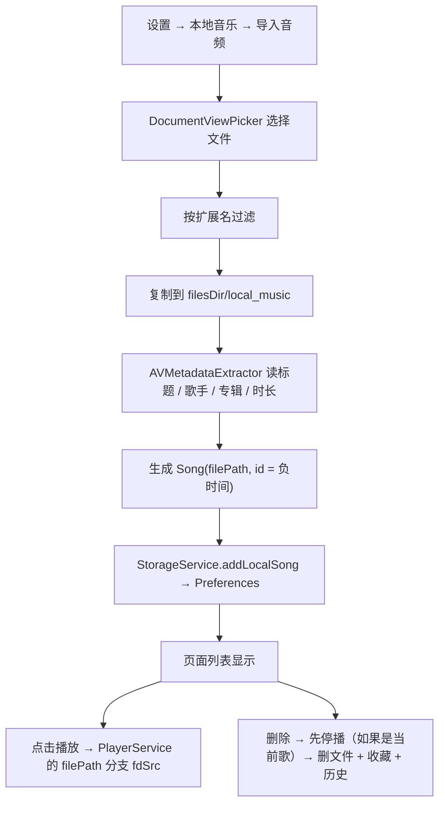
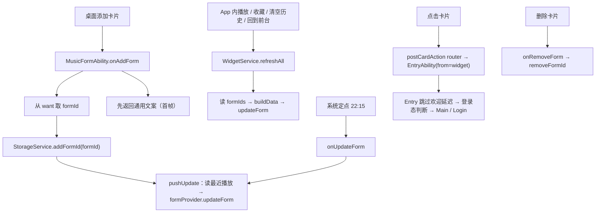

# 清听（HarmonyMusicApp）学习文档

> **用途**：按模块和功能理解本项目，准备课程答辩。<br>
> **源码基线**：`main` 分支，提交 `03a89fd`（2026-10-25）。<br>
> **阅读建议**：先看第 0 章的整体图，再按第 1～9 章顺序阅读；第 10、11 章用于验收和答辩。<br>
> **图表说明**：流程图使用 Mermaid，GitHub、语雀、Typora（安装 Mermaid 插件）等可直接渲染；不渲染时按箭头上的文字理解即可。<br>
> **时间紧**：优先看第 0、1、4、8、11 章，已经覆盖答辩主链。<br>
> **路径约定**：`entry/src/main/ets/` 下的源码在文中常简写为 `Xxx.ets`；`module.json5` 在 `entry/src/main/`；`form_config.json` 在 `entry/src/main/resources/base/profile/`；`demo_loop.wav` 在 `entry/src/main/resources/rawfile/`。

---

## 0. 项目全貌

### 0.1 一句话理解

“清听”是一个 HarmonyOS 在线音乐播放器：**首页 / 搜索 / 收藏 / 我的** 四个 Tab，点歌后由 `AVPlayer` 播放，支持歌词、音质切换、后台播控、桌面服务卡片，以及断网时可用的本地示例音频和本地文件导入。

项目基于开源项目 `wyyhm6` 二次开发，重点是补齐产品闭环（登录、收藏、历史、设置、卡片、兜底），不是重写播放器内核。

### 0.2 技术栈

| 技术 | 在本项目中的用途 | 关键文件 |
| --- | --- | --- |
| ArkTS + ArkUI | 声明式 UI、状态管理（`@State` / `@Prop` / `@StorageLink`） | `entry/src/main/ets/pages/` |
| Stage 模型 UIAbility | 两个 Ability：登录流程、主界面与播放 | `EntryAbility.ets`、`MainAbility.ets` |
| AVPlayer | 真正负责解码和播放音频 | `PlayerService.ets` |
| AVSession + 后台任务 | 通知栏 / 媒体面板控制、后台播放 | `AudioSessionService.ets` |
| Preferences | 保存登录态、收藏、历史、设置 | `StorageService.ets`、`AuthService.ets` |
| HTTP | 调用网易云公开接口：搜索、推荐、歌单、歌词、播放地址 | `ApiService.ets` |
| FormExtensionAbility | 桌面 2×2 服务卡片 | `MusicFormAbility.ets` |
| HdsNavigation / HdsTabs | 系统风格标题栏与底部 Tab | `Index.ets` 等页面 |

### 0.3 分层架构图



**看图要点：**

- 页面只负责显示和接收点击，不直接操作 `AVPlayer`。
- `PlayerService` 是播放的唯一入口，负责调度、状态和错误。
- 业务数据（收藏、历史、设置）统一走 `StorageService`，登录态由 `AuthService` 单独管理；页面不直接读 Preferences。
- 业务网络数据（搜索、推荐、歌单、歌词、播放地址）统一走 `ApiService`；封面下载在 `AudioSessionService` / `ImageCacheService` 内单独处理。

### 0.4 模块职责速查

| 模块 | 主要文件 | 一句话职责 |
| --- | --- | --- |
| 启动 / 登录 | `EntryAbility.ets`、`WelcomePage.ets`、`LoginPage.ets`、`AuthService.ets` | 欢迎页、演示登录、登录态持久化、进入主界面 |
| 主界面 | `Index.ets` | 四个 Tab、首页推荐、搜索 UI、收藏 / 我的入口、迷你播放器 |
| 网络数据 | `ApiService.ets`、`CacheService.ets` | 搜索、推荐、歌单、歌词、播放地址；缓存、超时、错误 |
| 播放 | `PlayerService.ets` | 播放 / 暂停 / 切歌 / 进度 / 音质 / 音源分支 / 历史记录 |
| 播放页 | `PlayPage.ets`、`PlayerControls.ets`、`LyricView.ets` | 深色沉浸页面、控制条、歌词滚动 |
| 本地存储 | `StorageService.ets` | 收藏、历史、搜索历史、设置、卡片 formId、本地音乐 |
| 后台播控 | `AudioSessionService.ets` | 通知栏 / 媒体面板、后台长时任务、封面和进度上报 |
| 服务卡片 | `MusicFormAbility.ets`、`WidgetService.ets`、`MusicWidgetCard.ets` | 2×2 卡片显示最近播放并能拉起 App |
| 本地音乐 | `LocalMusicService.ets`、`LocalMusicPage.ets` | 选择文件、复制到私有目录、读元数据、播放 / 删除 |
| 视觉 | `ThemeManager.ets`、`SettingsPage.ets` | 颜色 token、背景图、光感档位、深色播放页 |

### 0.5 推荐学习顺序

1. **启动到主界面**（第 1 章）——先弄清 App 怎么进来。
2. **四个 Tab 和首页**（第 2 章）——知道主界面有哪些数据。
3. **搜索与网络**（第 3 章）——理解数据怎么从接口变成列表。
4. **播放核心**（第 4 章）——最重要，答辩最容易被问。
5. **歌词与播放页**（第 5 章）——播放页的显示与交互。
6. **收藏 / 历史 / 本地音乐**（第 6 章）——本地数据怎么存。
7. **后台播控**（第 7 章）——通知栏为什么能控制播放。
8. **服务卡片**（第 8 章）——桌面卡片怎么更新。
9. **主题 / 背景 / 示例音频**（第 9 章）——视觉与离线兜底。
10. **测试与答辩**（第 10、11 章）——准备验收材料。

---

## 1. 启动与登录模块

### 1.1 这一模块解决什么问题

冷启动后，用户应该先看到欢迎页；如果之前登录过，就直接进主界面；没登录就去登录页。登录只是演示账号 `demo / 123456`，不连接真实账号系统。

### 1.2 参与角色

| 角色 | 作用 |
| --- | --- |
| `EntryAbility` | “门卫 + 登记处”：只负责欢迎页 / 登录页，不初始化音频 |
| `WelcomePage` | 显示 1.5 秒，然后判断登录态 |
| `LoginPage` | 输入账号密码、勾选协议、调用登录 |
| `AuthService` / `AuthValidator` | 校验固定账号、保存登录态（不保存密码） |
| `MainAbility` | “播放厅”：主界面、播放、音频会话；带登录门禁 |

### 1.3 启动流程图



### 1.4 关键代码讲解

#### ① 先取 Want 参数，再 `await`

`EntryAbility.onCreate` 开头：

```ts
const params = want.parameters;
this.showLogin = params !== undefined && params['showLogin'] === true;
const fromWidget: boolean = params !== undefined && params['from'] === 'widget';
AppStorage.setOrCreate<boolean>('skipWelcomeDelay', fromWidget);
```

解释：

- `showLogin=true`：退出登录、或未登录被门禁送来时，直接打开登录页，不经过欢迎页。
- `from=widget`：从桌面卡片进来时，欢迎页不再等 1.5 秒。
- 为什么必须写在第一个 `await` 之前？框架不会等异步 `onCreate` 完成再创建窗口，参数必须同步解析好。

之后根据参数选页面：

```ts
const page: string = this.showLogin ? 'pages/LoginPage' : 'pages/WelcomePage';
windowStage.loadContent(page, ...);
```

#### ② 欢迎页 1.5 秒后分流

```ts
this.timer = setTimeout(() => { this.enterApp(); }, 1500);
// ...
const loggedIn: boolean = await this.authService.isLoggedIn();
if (!loggedIn) {
  router.replaceUrl({ url: 'pages/LoginPage' });
  return;
}
await context.startAbility({ bundleName, abilityName: 'MainAbility' });
setTimeout(() => { context.terminateSelf(); }, 800);
```

解释：

- `aboutToDisappear` 会清理 timer，避免页面销毁后还跳转。
- `startAbility` 后等 800ms 再 `terminateSelf`，是给新 Ability 留出创建窗口的时间，避免同进程切换时窗口被提前销毁。项目里 Entry → Main、登录 → Main、退出登录 → Entry 都用了这个节奏。

#### ③ 登录页校验与保存

```ts
if (!this.agreed) { /* 提示先勾选 */ return; }
const validation = AuthService.validate(this.username, this.password);
// ...
const result = await this.authService.login(this.username, this.password);
await context.startAbility({ bundleName, abilityName: 'MainAbility' });
```

`AuthService.login` 只写两个值：

```ts
await prefs.put(IS_LOGGED_IN_KEY, true);
await prefs.put(NICKNAME_KEY, DEMO_NICKNAME);
```

解释：不保存密码；登录态写在独立的 `auth_storage` Preferences 文件里。

#### ④ MainAbility 的登录门禁

```ts
this.authCheck = this.authService.isLoggedIn();
this.authCheck.then(async (loggedIn: boolean) => {
  if (!loggedIn) {
    await this.context.startAbility({
      bundleName: this.context.applicationInfo.name,
      abilityName: 'EntryAbility',
      parameters: { showLogin: true }
    });
    setTimeout(() => this.context.terminateSelf(), 800);
    return;
  }
  // 已登录：初始化主题、音频会话、图片缓存
});
```

窗口创建时再等这个结果：

```ts
const check = this.authCheck ?? Promise.resolve(false);
check.then((loggedIn: boolean) => {
  if (!loggedIn) return;
  windowStage.loadContent('pages/Index', ...);
});
```

解释：

- 即使别人直接 `aa start MainAbility`，没登录也会被送回登录页。
- `onCreate` 是异步的，所以用 `authCheck` Promise 保存结果，`onWindowStageCreate` 再等它。

### 1.5 答辩要点

- **问：为什么要两个 Ability？**<br>
  答：职责分离。Entry 只处理欢迎 / 登录，不持有音频；Main 负责主界面和播放。登录成功后 Entry 结束自己，返回键不会回到欢迎页；Main 有登录门禁，避免绕过登录。

- **问：登录是真的吗？**<br>
  答：不是，是课程演示用的固定账号，本地纯函数校验，不联网、不保存密码。

- **问：为什么延迟 0.8 秒？**<br>
  答：Ability 切换时新窗口还没建好，直接结束旧 Ability 可能把窗口提前销毁；延迟是为了窗口交接。

> **一句话**：Entry 管进门，Main 管播放；没登录进不了 Main。

---

## 2. 主界面与四个 Tab

### 2.1 主界面结构

`Index` 是 MainAbility 加载的唯一主页面，使用 `HdsTabs` 放四个 `TabContent`：

| Tab | 内容 | 数据来源 |
| --- | --- | --- |
| 首页 | 搜索胶囊、推荐歌单、为你推荐、最近播放、本地精选 | ApiService + StorageService |
| 搜索 | 输入框、历史、结果列表、只看可播放 | ApiService + StorageService |
| 收藏 | 收藏 / 最近播放两个 segment | 父组件传入的 `favorites` / `history` |
| 我的 | 个人卡、统计、设置、退出登录 | AuthService + StorageService |

底部 Tab 栏右侧的迷你播放器不是独立组件，而是通过 `HdsTabs` 的 `barFloatingStyle.miniBar` 注入 `MiniBarBuilder`。**注意**：`components/MiniPlayer.ets` 是旧版组件，当前没有挂载，实际生效的是 `Index.ets` 里的 `MiniBarBuilder`。

### 2.2 数据刷新：父组件管数据

`Index` 持有 `favorites` 和 `history` 两个 `@State`，`FavoritesView` 只通过 `@Prop` 接收并显示。刷新时机如下：



```ts
async refreshLibrary() {
  this.favorites = await this.storageService.getFavorites();
  this.history = await this.storageService.getPlayHistory();
}
```

解释：收藏页不自己读 Preferences，避免多个页面各读一份、状态不一致；`Index` 是“数据的唯一来源”。

### 2.3 首页加载

`loadHome()` 依次调用：

1. `getNewAlbums(8)`：新专辑；
2. `getPersonalizedPlaylists(8)`：推荐歌单；
3. `getRecommendedSongs(30)`：推荐歌曲。

第一个专辑作为 16:9 精选大卡；没有专辑就用推荐歌单；都没有就把 `homeError=true`，显示“网络暂时不可用”+ 重试按钮。页面下方始终有“本地精选”，保证断网也有内容可点。

### 2.4 迷你播放器

- 有当前歌曲时，底部 Tab 栏出现圆形封面。
- 播放时每隔 50ms 旋转 1°，暂停 / 停止就停在当前角度。
- 点击封面进入 `PlayPage`；展开状态还能看到歌名、歌手和播放 / 暂停按钮。

```ts
startMiniCdRotation() {
  if (this.miniCdTimer) return;
  this.miniCdTimer = setInterval(() => {
    this.miniCdRotation = (this.miniCdRotation + 1) % 360;
  }, 50);
}
```

解释：`aboutToDisappear` / `onPageHide` 会清 timer；歌曲变化或状态变化时决定启动 / 停止。

### 2.5 退出登录

`handleLogout` 的顺序：

```text
停止播放 → release AVPlayer → reset 状态 → destroy AVSession
→ AuthService.logout 清登录态 → startAbility(EntryAbility, showLogin=true)
→ 0.8 秒后结束 MainAbility
```

这样做保证退出后不会继续出声，也不会把上一个账号的播放状态带回来。

### 2.6 答辩要点

- **问：收藏页数据怎么刷新？**<br>
  答：Index 统一读 Preferences，通过 `@Prop` 下发；切 Tab、返回页面、收藏 / 取消收藏、清空历史都会触发 `refreshLibrary`。

- **问：迷你播放器怎么转？**<br>
  答：Index 里 50ms 定时器改旋转角度，播放状态驱动启停，页面隐藏 / 销毁清理定时器。

- **问：四个 Tab 是怎么做的？**<br>
  答：`HdsTabs` + `TabContent` + `BottomTabBarStyle`，系统图标用 `SymbolGlyphModifier` 设置选中 / 未选中颜色。

> **一句话**：Index 管数据，子组件只负责显示。

---

## 3. 搜索与网络数据模块

### 3.1 搜索流程图



UI 侧关键点：

- `runSearch` 先把 `searchRequestId++`，请求回来后只有“还是最新请求”才允许写列表，防止旧请求覆盖新结果。
- 搜索历史先写入本地，再发网络请求；失败也不丢历史。
- `loadMore` 只有成功才增加页码；失败保留已加载内容并显示“加载失败，点击重试”。
- “只看可播放”用 `playerService.canPlay(song)` 过滤。

```ts
const requestId: number = ++this.searchRequestId;
// ...
const result = await this.apiService.searchMusic(keyword, 1);
if (requestId !== this.searchRequestId) return; // 过期结果直接丢弃
```

解释：快速改关键词 / 清空输入时，先发出的请求可能后返回；这个编号是“只认最新请求”的凭据。

### 3.2 ApiService 的统一套路

每个接口基本是：

1. 拼缓存 key，先查 `CacheService`；
2. 发 HTTP 请求，连接 / 读取各 10 秒超时；
3. 判断 `responseCode === 200` 和业务 `code === 200`；
4. 把接口字段映射成项目自己的 `Song` / `PlaylistInfo`；
5. 写缓存；
6. 失败返回空数组 / `null` 或 `error: true`，不把异常抛到页面。

搜索请求使用 POST 表单，地址是 `https://music.163.com/api/cloudsearch/pc`，并带 `Referer`、`User-Agent`、`Cookie` 等请求头。这些头是模仿浏览器，避免被接口的 WAF 拦截；不是用户登录，也不包含隐私。

```ts
const playMaxBr = item.privilege && item.privilege.pl ? item.privilege.pl : 0;
const fee = item.fee !== undefined ? item.fee : 0;
const playable = playMaxBr > 0 || fee === 0 || fee === 8;

return {
  id: item.id,
  name: item.name,
  artist: item.ar.map(a => a.name).join('/'),
  album: item.al.name,
  coverUrl: item.al.picUrl.replace('http://', 'https://'),
  duration: item.dt,
  url: '',
  lyric: '',
  availableQualities: qualities,
  fee,
  playable,
  maxBr: playMaxBr > 0 ? playMaxBr : this.maxQualityBr(qualities)
};
```

解释：

- `fee=0`（免费）、`fee=8`（部分免费）可以播；`privilege.pl` 是接口给出的可播放最高码率，大于 0 也认为可播。
- `playable` 会一路传到 UI，用来显示 VIP / 付费标签、过滤“只看可播放”和切歌时跳过。
- 不同接口的判定略有差异：搜索 / 推荐看 `privilege.pl` 和 `fee`，歌单详情 / 歌曲详情只看 `fee`（见第 11 章的“不足”）。

### 3.3 缓存与超时

| 数据 | 缓存时长 | 说明 |
| --- | --- | --- |
| 搜索结果 | 3 分钟 | key 含关键词、页码、条数 |
| 播放地址 | 5 分钟 | 地址可能过期，不能久存 |
| 歌词 | 30 分钟 | 基本不变 |
| 歌曲详情 | 15 分钟 | — |
| 歌单详情 | 10 分钟 | — |
| 歌单搜索 | 5 分钟 | — |
| 热门歌单 | 10 分钟 | — |

`CacheService` 是内存缓存：Map 存 JSON 字符串 + 过期时间 + 访问顺序，最多 200 条；进程退出就没了。超时统一 10 秒，避免断网时一直转圈。

### 3.4 歌单详情：为什么能显示全部歌曲

接口返回的 `tracks` 通常只有前 10 首，但还有一个 `trackIds`（完整歌曲 id 列表）。`getPlaylistDetail` 会：

1. 先映射已有的 `tracks`；
2. 用 `Set` 找出缺少的 id；
3. 每 100 首一批调用 `batchGetSongDetails` 补全；
4. 合并后缓存并返回。

一句话：**`tracks` 是试吃装，`trackIds` 才是完整菜单，缺的用批量详情补齐。**

### 3.5 错误与兜底

- **搜索**：`error: true` → “网络连接失败”+ 重试 +“播放本地示例”；空数组 → “没有找到相关歌曲”。两种情况分开。
- **首页**：没有推荐歌单 → 错误卡 + 本地精选；点“重新加载”再请求。
- **播放**：拿不到播放地址 → toast“暂无可用播放地址”，状态回到 `STOPPED`，不会一直 loading。
- **VIP / 付费**：列表显示标签，点击前拦截，上一首 / 下一首自动跳过。

### 3.6 答辩要点

- **问：搜索怎么防止旧结果覆盖新结果？**<br>
  答：不是防抖，是请求编号；每次搜索递增 `requestId`，回来时不是最新就丢弃。

- **问：为什么用内存缓存？**<br>
  答：接口数据变化快、课程演示单进程；内存缓存实现简单，避免重复请求和页面切换卡顿。App 重启后缓存自然清空，也不会读到过期数据。

- **问：VIP 歌为什么不能播？**<br>
  答：第三方公开接口对会员 / 版权歌曲返回空 URL；App 不绕过版权，只做标记、过滤、跳过和本地导入。

> **一句话**：页面不管网络细节，ApiService 统一请求、映射、缓存、兜底。

---

## 4. 播放核心模块

### 4.1 播放器服务的位置

`PlayerService` 是单例，整个 App 只有一个：

- 页面调用 `playSong / pause / playNext / ...`；
- 它控制 `AVPlayer`，把状态通过 listener 通知 UI；
- 它统一写播放历史、刷新服务卡片；
- 它把媒体按钮回调注册到 `AudioSessionService`。

### 4.2 一次点歌的完整流程



**三种音源：**

| 音源 | 判断字段 | 加载方式 | 歌词 |
| --- | --- | --- | --- |
| 本地示例 | `assetName` | `resourceManager.getRawFd` → `fdSrc` | 无，显示“示例音频，无歌词” |
| 本地导入 | `filePath` | `fs.openSync` → `fdSrc` | 无，显示“本地音乐，无歌词” |
| 在线歌曲 | 两个字段都没有 | `ApiService.getSongUrl` → `player.url` | 请求并解析歌词 |

解释：`fdSrc` 是直接把文件描述符交给 AVPlayer，不需要网络；`url` 是流式播放网络地址。切歌 / 释放时会关闭旧 fd，避免资源泄漏。

### 4.3 播放状态机



UI 只认 `PlayerState` 四种：`PLAYING / PAUSED / STOPPED / LOADING`。AVPlayer 自己的 `initialized → prepared → playing` 在 `initPlayer` 里消化掉，页面不用关心底层细节。

### 4.4 快速切歌怎么不乱

```ts
playSong(song: Song): Promise<void> {
  const epoch: number = this.playbackEpoch;
  const run: Promise<void> = this.playQueue.then(async () => {
    if (epoch !== this.playbackEpoch) return;
    await this.doPlaySong(song, epoch);
  });
  this.playQueue = run.catch((error: Error) => { /* 记录错误 */ });
  return run;
}
```

两层保护：

1. **串行队列**：所有播放请求排队，避免两个 `playSong` 同时释放 / 创建 AVPlayer。
2. **epoch 取消标记**：`reset()` / `release()` 时递增 `playbackEpoch`，旧任务发现版本不一致就直接退出。
3. 还有一层：AVPlayer 回调里检查 `this.avPlayer !== player`，旧播放器的事件不会写到新状态。

### 4.5 播放历史为什么只写一次

```ts
private async recordHistoryIfNeeded(): Promise<void> {
  if (this.historyRecorded || !this.currentSong) return;
  this.historyRecorded = true;
  await this.storageService.addPlayHistory(this.currentSong);
  await WidgetService.refreshAll();
}
```

它在 AVPlayer 进入 `playing` 时调用。所有入口（首页、搜索、歌单、播放页、上一首 / 下一首）最终都走 `PlayerService`，所以只需要在这里写一次；`historyRecorded` 防止同一首歌在暂停 / 继续时重复写。

### 4.6 上一首 / 下一首与播放模式

`findPlayableIndex(start, step)` 会从起点按方向找，跳过 `canPlay` 为 false 的歌曲，并用 `% length` 环绕。

```ts
canPlay(song: Song): boolean {
  if (song.assetName || song.filePath) return true;
  return song.playable !== false;
}
```

| 模式 | 行为 |
| --- | --- |
| 顺序 | 下一首 = 当前 + 1，到末尾回到开头（源码现状） |
| 列表循环 | 与顺序在代码里走同一分支，也会环绕 |
| 随机 | 随机选一个起点，再找可播放 |
| 单曲 | 重播当前歌曲；当前不可播时提示 |

说明：从代码看，顺序和列表循环目前没有行为差异，主要是图标不同；如果答辩被问，可以如实说明，并说改进方式是给顺序模式加“到末尾停止”。这是很好的“我知道自己代码”的加分点。

### 4.7 音质

- 默认选择“极高”（320k）；如果用户在音质弹层选择更高档，`getSongUrl` 会把请求码率限制在歌曲 `maxBr` 内，避免先请求 320k 再回退。
- 高码率失败会自动用标准音质再请求一次。
- 切换音质会重新加载当前歌曲；当前实现从 0 秒开始，暂停状态下也会开始播放。这是已知行为，答辩时可以主动说明。

### 4.8 答辩要点

- **问：为什么播放逻辑都放在 PlayerService？**<br>
  答：单一入口，所有页面共用一份状态；历史、卡片、通知栏、错误提示都只需要接一次。

- **问：AVPlayer 有几个？**<br>
  答：同一时间一个；每次播放新歌先释放旧的再创建新的，避免状态互相干扰。

- **问：快速点好几首歌会怎样？**<br>
  答：请求排队执行；`reset` / `release` 后旧任务被 epoch 作废，切歌过程中的旧播放器事件被“播放器身份检查”忽略，不会交叉写状态。

- **问：本地示例怎么做到离线？**<br>
  答：rawfile 里的 `demo_loop.wav` 用 `getRawFd` 拿 fd，直接交给 AVPlayer，不经过网络。

> **一句话**：页面只按遥控器，PlayerService 负责排队、选音源、驱动 AVPlayer、写历史。

---

## 5. 歌词与播放页模块

### 5.1 播放页结构

`PlayPage` 是固定深色页面：

```text
背景：封面放大 + 模糊 + 深色遮罩（没有封面用深色渐变）
顶部：返回、标题、音质、收藏
中间：Swiper 两页 —— 封面信息 / 歌词
底部：PlayerControls（进度、模式、上一首、播放/暂停、下一首、播放列表）
弹层：音质选择 / 播放列表
```

它使用 `playerBg / playerSurface / playerText / playerMuted / playerAccent` 这组独立 token，进入时设置，退出时恢复浅色值；不会把主界面变暗。进入时还会把状态栏内容切白，退出恢复；播放时封面缓慢旋转，暂停 / 停止停下。

### 5.2 歌词流程图



### 5.3 歌词解析

```ts
const match = line.match(/\[(\d{2}):(\d{2})\.(\d{2,3})\](.*)/);
if (match) {
  const time = parseInt(match[1]) * 60 + parseInt(match[2]) + parseInt(match[3]) / 1000;
  const text = match[4].trim();
  if (text) lines.push({ time, text });
}
lines.sort((a, b) => a.time - b.time);
```

解释：只解析逐行 LRC（`[分:秒.毫秒]歌词`），过滤空行，按时间排序。项目没有做逐字歌词。

### 5.4 当前行怎么找

```ts
let newIndex = -1;
for (let i = this.lyrics.length - 1; i >= 0; i--) {
  if (this.currentPosition >= this.lyrics[i].time) { newIndex = i; break; }
}
if (newIndex !== this.currentLyricIndex) {
  this.currentLyricIndex = newIndex;
  this.notifyLyricChange(newIndex, newIndex >= 0 ? this.lyrics[newIndex].text : '');
}
```

解释：从最后一行往前找，第一个“时间 ≤ 当前进度”的行就是当前行；只有索引变化才通知 UI，避免每 100ms 都重绘。`LyricView` 收到通知后高亮并滚动；列表顶部有一个 120vp 占位，所以滚动索引要 +1。

### 5.5 点击歌词

点击某行时调用 `playerService.seekTo(lyric.time)`，播放器跳转，下一轮 `timeUpdate` 会重新计算当前行。

### 5.6 答辩要点

- **问：歌词怎么和播放同步？**<br>
  答：AVPlayer 的 `timeUpdate` 更新进度，`PlayerService` 用进度找当前行，通知 `LyricView` 高亮和滚动。

- **问：为什么只有整行高亮？**<br>
  答：接口只提供整行时间戳；逐字需要额外的 klyric 数据，项目没有接入，所以按行同步。

- **问：深色播放页会影响主界面吗？**<br>
  答：不会，播放页用独立的 `player*` token，`aboutToDisappear` 恢复；主界面始终浅色。

> **一句话**：进度驱动歌词，索引不变不重绘。

---

## 6. 收藏、历史与本地存储模块

### 6.1 本地数据地图

| 文件 / 目录 | 存什么 | 谁用 |
| --- | --- | --- |
| `auth_storage` Preferences | `is_logged_in`、`nickname` | AuthService、登录门禁 |
| `music_app_storage` Preferences | 收藏、历史、搜索历史、音质、效果档位、背景、formId、本地音乐 | StorageService、页面、服务卡片 |
| 应用私有目录 `local_music/` | 用户导入的音频文件 | LocalMusicService、PlayerService |
| 缓存目录 `cover_cache/` | 网络封面 | ImageCacheService |
| `rawfile` | `demo_loop.wav`、内置背景 | PlayerService、SettingsPage |

列表类数据（收藏、历史、本地音乐、formId）以 JSON 字符串保存；音质、效果档位、透明度等是数字或布尔值。收藏最多 200 首，播放历史 / 搜索历史最多 50 条。

### 6.2 收藏与历史

```ts
async addPlayHistory(song: Song): Promise<void> {
  let history = await this.getPlayHistory();
  history = history.filter(item => item.id !== song.id);
  history.unshift(song);
  if (history.length > MAX_HISTORY_SIZE) history = history.slice(0, MAX_HISTORY_SIZE);
  await prefs.put(PLAY_HISTORY_KEY, JSON.stringify(history));
  await prefs.flush();
}
```

解释：先按 id 去重，再插到最前，超过 50 条截断。收藏同理，只是上限 200；`toggleFavorite` 判断存在就删、不存在就加。

### 6.3 本地音乐导入流程



关键代码：

```ts
const dir = `${context.filesDir}/local_music`;
if (!fs.accessSync(dir)) fs.mkdirSync(dir);
const srcFile = fs.openSync(uri, fs.OpenMode.READ_ONLY);
try { fs.copyFileSync(srcFile.fd, destPath); } finally { fs.closeSync(srcFile); }
```

```ts
const extractor = await media.createAVMetadataExtractor();
extractor.fdSrc = { fd: file.fd, offset: 0, length: stat.size };
const metadata = await extractor.fetchMetadata();
```

解释：

- 文件复制到应用私有目录，卸载 App 就一起删除；不上传，不打包进仓库。
- 读不到标题 / 歌手时用文件名和“本地导入”兜底。
- 删除时会：如果是当前播放歌曲先停播重置 → 删文件 → 从本地列表、收藏、历史中移除。

### 6.4 答辩要点

- **问：为什么用 Preferences 不用数据库？**<br>
  答：课程项目数据量小，键值和 JSON 足够；Preferences 轻量、无需建表。缺点是复杂查询和大数据量不合适，产品化应换 RDB。

- **问：收藏数据在哪？**<br>
  答：`music_app_storage` 里的 `favorites`，JSON 数组；页面通过 StorageService 读写。

- **问：卸载 App 数据还在吗？**<br>
  答：Preferences 和私有目录都会随卸载删除；本地导入文件也一样。

> **一句话**：本地数据统一走 StorageService，音频文件放私有目录。

---

## 7. 后台播放与通知模块

### 7.1 三个角色的关系

```text
PlayerService（播放决定权）
   ↕ 回调
AudioSessionService（媒体会话 + 通知栏 + 后台任务）
   ↕
AVSession / backgroundTaskManager（系统）
```

用户在通知栏 / 媒体面板点播放、暂停、上一首、下一首、拖动进度，系统会发 AVSession 事件；`AudioSessionService` 把事件转给 `PlayerService` 的方法。

### 7.2 初始化与回调注册

`PlayerService` 构造函数里：

```ts
const mediaCallbacks: MediaCallbacks = {
  onPlay: () => { this.play(); },
  onPause: () => { this.pause(); },
  onNext: () => { this.playNext(); },
  onPrevious: () => { this.playPrevious(); },
  onSeek: (position) => { this.seekTo(position); },
};
this.audioSessionService.setMediaCallbacks(mediaCallbacks);
```

`AudioSessionService.createAVSession` 把 AVSession 的 `play / pause / playNext / playPrevious / seek` 事件接到这些回调上。注意 `seek` 系统传毫秒，回调里除以 1000 转成秒。

### 7.3 状态、进度和封面

- **播放状态**：`updatePlaybackState` 映射成 AVSession 状态；进入 `PLAYING` 时启动后台长时任务，`STOPPED` 时停止。
- **进度**：`updateProgress` 每 1 秒最多上报一次，避免刷屏。
- **封面**：`updateMetadata` 下载封面（15 秒超时）转成 `PixelMap`，带缓存；失败就不带封面，不影响播放。
- **点击通知栏 / 媒体面板**：WantAgent 指向 `MainAbility`，不会回到登录页。
- **权限与配置**：`module.json5` 里 `audioPlayback` 后台模式、`KEEP_BACKGROUND_RUNNING`、`INTERNET` 都放在 MainAbility 场景。

### 7.4 答辩要点

- **问：后台播放怎么实现？**<br>
  答：MainAbility 声明 `audioPlayback` 后台模式；AVSession 激活后，`PLAYING` 时启动长时任务，系统才允许继续播。

- **问：通知栏按钮为什么能控制 App？**<br>
  答：`PlayerService` 把播放方法注册成 AVSession 回调，系统事件进来后调用同一套方法。

- **问：为什么通知点击进的是主界面？**<br>
  答：WantAgent 固定指向 MainAbility；MainAbility 有登录门禁，未登录会被送回登录页。

> **一句话**：AVSession 是系统和播放器之间的对讲机。

---

## 8. 服务卡片模块

### 8.1 三块组成

| 部分 | 文件 | 职责 |
| --- | --- | --- |
| 卡片 UI | `pages/widget/MusicWidgetCard.ets` | 2×2 的显示，点击拉起 App |
| 卡片生命周期 | `formability/MusicFormAbility.ets` | 添加 / 更新 / 删除时读写数据 |
| 数据与刷新 | `services/WidgetService.ets` | 从最近播放生成文案，调用 `formProvider` 更新 |

### 8.2 完整流程图



### 8.3 关键代码

`onAddForm` 取 formId 并登记：

```ts
const value = params[formInfo.FormParam.IDENTITY_KEY];
if (typeof value === 'string') formId = value;
if (formId) this.registerAndRefresh(formId); // addFormId + pushUpdate
return formBindingData.createFormBindingData(initial); // 先给首帧通用文案
```

`WidgetService` 生成数据：

```ts
const history = await StorageService.getInstance().getPlayHistory();
if (history.length > 0) {
  return { title: history[0].name, subtitle: history[0].artist, status: '继续听' };
}
return { title: '今天想听什么？', subtitle: '打开清听', status: '发现好音乐' };
```

点击卡片：

```ts
postCardAction(this, {
  action: 'router',
  bundleName: 'com.example.harmonymusicapp',
  moduleName: 'entry',
  abilityName: 'EntryAbility',
  params: { from: 'widget' }
});
```

解释：卡片点击进入 EntryAbility，`from=widget` 让欢迎页跳过 1.5 秒；已登录直接进主界面，未登录到登录页。

### 8.4 更新时机

1. **桌面添加时**：`onAddForm` 先返回通用文案，再异步读取最近播放刷新。
2. **App 内播放成功**：`recordHistoryIfNeeded` 写历史后调用 `WidgetService.refreshAll()`。
3. **回到前台**：`MainAbility.onForeground()` / `Index.onPageShow()` 刷新。
4. **系统定点**：`form_config.json` 的 `scheduledUpdateTime: "22:15"` 触发 `onUpdateForm`。
5. **删除卡片**：`onRemoveForm` 把 formId 清掉。

### 8.5 答辩要点

- **问：卡片数据从哪来？**<br>
  答：本地最近播放，不依赖网络；没有历史就显示“发现好音乐”。

- **问：卡片怎么做到动态更新？**<br>
  答：添加时把 formId 存进 Preferences；App 内播放后按 formId 调 `formProvider.updateForm`，系统定时也会调 `onUpdateForm`。

- **问：卡片第一帧为什么是通用文案？**<br>
  答：`onAddForm` 需要同步返回，读取 Preferences 是异步的，所以先给默认值，随后立即刷新。

- **问：有什么风险？**<br>
  答：FormExtensionAbility 和主应用共用同一个 Preferences 文件，两端同时写理论上有文件竞争；演示数据量小，产品化应拆分存储或使用 DataShare。

> **一句话**：formId 是卡片的身份证，最近播放是卡片的内容。

---

## 9. 主题、背景与本地示例

### 9.1 颜色 token 怎么到页面

`ThemeManager` 把一组颜色写入 `AppStorage`：

```ts
AppStorage.setOrCreate<string>('bgPrimary', colors.bgPrimary);
AppStorage.setOrCreate<string>('bgSecondary', colors.bgSecondary);
AppStorage.setOrCreate<string>('textPrimary', colors.textPrimary);
AppStorage.setOrCreate<string>('accent', colors.accent);
```

页面用 `@StorageLink('bgPrimary')` 绑定，值变了 UI 自动更新。主界面固定浅色（Entry / Main 初始化时 `themeManager.init(false)`）；播放页用另一组 `player*` token，互不污染。

### 9.2 背景设置

- **内置 7 张背景图**：从 `rawfile/backgrounds` 复制到 `filesDir/backgrounds`，存 `file://` 路径。
- **相册选图**：`PhotoViewPicker` 返回 URI，直接存。
- `bgImage` + `bgOpacity` 存 Preferences，也同步到 AppStorage；主界面 / 搜索 / 收藏 / 歌单页在内容底部铺图 + 半透明遮罩。
- 设置页可调 5%–60% 透明度；内置背景至少 35%，保证文字可读。
- 播放页不用背景图，固定深色沉浸。

### 9.3 本地示例音频

`MockData.LOCAL_DEMO_SONG`：

```ts
{
  id: -1,
  name: '清听 · 示例曲',
  artist: '清听',
  album: '本地示例',
  duration: 24000,
  url: '',
  coverUrl: '',
  lyric: '',
  assetName: 'demo_loop.wav'
}
```

播放时走 `getRawFd` 分支，不请求网络、不请求歌词。它出现在首页“本地精选”、搜索断网页的“播放本地示例”、设置页入口，保证答辩现场断网也能演示。

### 9.4 答辩要点

- **问：背景图怎么保证文字可读？**<br>
  答：图片上盖一层可调透明度的遮罩，内置背景至少 35%；列表在背景开启时变透明。

- **问：为什么播放页不用背景图？**<br>
  答：播放页固定深色沉浸，避免彩色背景干扰歌词和控制按钮；也让主界面和播放页有明显层次。

- **问：断网怎么演示？**<br>
  答：本地示例音频在 rawfile 里，走 `fdSrc` 不依赖网络；搜索失败页也提供入口。

> **一句话**：主界面可换背景，播放页永远深色；断网还有本地示例。

---

## 10. 测试与验收

### 10.1 单元测试

`entry/src/test/AuthService.test.ets` 覆盖 5 种情况：空账号、空密码、错误账号、错误密码、正确账号。加上基线 1 项，共 6 项。

```sh
export DEVECO_SDK_HOME="D:/DevEco Studio/sdk"
"D:/DevEco Studio/tools/hvigor/bin/hvigorw.bat" test --mode module -p module=entry@default -p product=default
```

结果文件：`entry/.test/default/intermediates/test/coverage_data/test_result.txt`。注意：hvigor 在测试失败时也可能返回 0，要看结果文件。

### 10.2 模拟器验收

`docs/验收测试记录.md` 记录了 T01–T19 全部通过，覆盖：

- 冷启动、登录正确 / 错误 / 记忆、退出登录；
- 四个 Tab、首页、搜索、收藏 / 历史；
- 播放控制、深色播放页、本地示例；
- 服务卡片添加 / 动态 / 点击；
- 通知 / 后台、品牌、多 Ability、API 异常 / 超时；
- 额外验证了 VIP 标记 / 过滤 / 跳过、本地音乐导入 / 删除 / 持久化。

### 10.3 构建与安装

```sh
export DEVECO_SDK_HOME="D:/DevEco Studio/sdk"
export MSYS_NO_PATHCONV=1
"D:/DevEco Studio/tools/hvigor/bin/hvigorw.bat" --mode module -p product=default assembleHap --no-daemon
```

产物：`entry/build/default/outputs/default/entry-default-unsigned.hap`。模拟器接受未签名 HAP；真机需要自己的调试签名。

### 10.4 答辩前自测清单

- [ ] 冷启动 → 欢迎页 → 登录 → 主界面
- [ ] 搜索“jay” → 播放免费歌 → 进度 / 歌词 / 暂停 / 下一首
- [ ] 收藏 / 取消收藏 → 收藏 Tab 刷新
- [ ] 播放一首歌 → 桌面卡片显示“继续听”
- [ ] 断网 / 接口失败 → 首页错误卡、搜索重试、本地示例播放
- [ ] 设置 → 本地音乐 → 导入 → 播放 → 删除
- [ ] 我的 → 退出登录 → 回登录页，且不再出声

---

## 11. 答辩准备

### 11.1 30 秒项目介绍

> “清听是一个基于 HarmonyOS Stage 模型的在线音乐播放器。它用 ArkTS/ArkUI 做界面，用 AVPlayer 播放，用 AVSession 和后台任务做通知栏与后台播放，用 Preferences 保存收藏、历史、登录态和设置。项目有欢迎 / 登录和主界面两个 Ability，四个 Tab，支持搜索、歌单、收藏、最近播放、歌词、音质、服务卡片和本地音频导入。针对第三方接口的 VIP / 版权限制，我做了可播放标记、过滤和跳过，并用项目自生成的本地示例音频保证断网也能演示。”

### 11.2 推荐演示顺序

1. 冷启动欢迎页 → 登录（先演示错误，再 `demo / 123456`）。
2. 首页推荐 → 搜索 → 播放免费歌 → 播放页（歌词、音质、播放列表）。
3. 收藏 → 收藏 Tab → 最近播放。
4. 我的 → 设置 → 背景 / 效果 → 本地音乐导入。
5. 退出登录 → 回登录页。
6. 桌面服务卡片 → 播放后更新 → 点击拉起。
7. 断网 / 接口失败 → 本地示例。

### 11.3 高频问题速答

| 问题 | 回答要点 |
| --- | --- |
| 为什么两个 Ability？ | 登录 / 主界面职责分离；Entry 不初始化音频；Main 有登录门禁；登录后 Entry 结束，返回键不回欢迎页。 |
| 登录是真的吗？ | 固定演示账号，本地纯函数校验，不联网、不保存密码、不连接真实账号系统。 |
| 数据存在哪？ | Preferences（收藏 / 历史 / 设置 / 登录态）+ 应用私有目录（导入音频、内置背景副本；相册背景保存 URI）。 |
| 为什么不用数据库？ | 数据量小、结构简单；Preferences 轻量。产品化可换 RDB。 |
| 播放怎么做的？ | PlayerService 单例统一入口 → AVPlayer；状态机 + 监听器通知页面；本地 / rawfile / 在线三种音源。 |
| 快速切歌会乱吗？ | 播放请求串行队列 + epoch 取消旧任务 + AVPlayer 身份检查。 |
| 音源从哪来？ | 网易云公开接口；VIP 歌拿不到 URL，不绕过版权；本地示例和本地导入兜底。 |
| 歌词怎么同步？ | 解析逐行 LRC → PlayerService 随进度找当前行 → LyricView 高亮滚动；点击歌词 seek。 |
| 后台播放？ | AVSession + 后台长时任务；通知栏按钮回调 PlayerService；WantAgent 指 MainAbility。 |
| 卡片怎么更新？ | formId 存 Preferences；播放后 `refreshAll`；系统 22:15 定点刷新；数据来自最近播放。 |
| 收藏为什么能刷新？ | Index 统一读 StorageService，通过 @Prop 下发；切 Tab / 返回 / 收藏 / 清空都会刷新。 |
| 你的难点？ | 快速切歌并发、Ability 窗口交接、服务卡片动态刷新、VIP 可播放判断、歌词同步。 |
| 有什么不足？ | 顺序播放和列表循环目前行为相同；切音质从 0 秒重载；图片缓存组件未接入主列表；卡片共享 Preferences 有理论并发风险；没有真实账号 / 后台数据库。 |
| 如果继续做？ | 首页请求并行化、播放模式差异化、歌词逐字、图片缓存接入、RDB / DataShare、真实账号。 |

### 11.4 答辩时的三条原则

1. **先说结论，再说代码**：例如“播放统一走 PlayerService，因为要保证历史和通知栏只写一次”。
2. **主动说取舍**：不做真实账号 / 数据库是范围控制，不是不会；把原因和替代方案说清楚。
3. **不要夸大**：项目基于 `wyyhm6`；VIP 不绕过；卡片的系统刷新受设备调度影响；本地示例是项目生成的无版权音频。

### 11.5 自测任务

不看文档，用 2 分钟复述：

1. 从点击图标到进入主界面，经过了哪些类？登录门禁在哪？
2. 从点击一首歌到听见声音，经过了哪些方法？三种音源怎么分支？
3. 播放历史为什么只写一次？卡片怎么知道要更新？

能顺畅说完，答辩主链就掌握了。

---

## 附录 A：源码阅读路线

如果要从头读代码，按这个顺序最省力。以下路径默认相对 `entry/src/main/ets/`（第 1 条除外）：

1. `entry/src/main/module.json5`：Ability、页面、权限、卡片配置。
2. `entryability/EntryAbility.ets` → `pages/WelcomePage.ets` → `pages/LoginPage.ets`。
3. `mainability/MainAbility.ets` → `pages/Index.ets`。
4. `services/AuthService.ets` + `services/AuthValidator.ets`。
5. `services/ApiService.ets` + `services/CacheService.ets`。
6. `services/PlayerService.ets` → `components/PlayerControls.ets` → `components/LyricView.ets` → `pages/PlayPage.ets`。
7. `services/StorageService.ets` → `pages/views/FavoritesView.ets` / `pages/views/ProfileView.ets`。
8. `services/AudioSessionService.ets`。
9. `formability/MusicFormAbility.ets` + `services/WidgetService.ets` + `pages/widget/MusicWidgetCard.ets`。
10. `services/LocalMusicService.ets` + `pages/LocalMusicPage.ets`。
11. `services/ThemeManager.ets` + `pages/SettingsPage.ets`。
12. `entry/src/test/AuthService.test.ets`。

## 附录 B：关键符号速查

| 文件 | 关键符号 | 作用 |
| --- | --- | --- |
| `EntryAbility.ets` | `onCreate`、`onWindowStageCreate` | 解析 Want、加载 Welcome / Login |
| `WelcomePage.ets` | `enterApp` | 1.5 秒后判断登录态并切换 Ability |
| `LoginPage.ets` | `doLogin` | 协议校验、账号校验、进入 Main |
| `MainAbility.ets` | `authCheck`、`onForeground`、`onDestroy` | 登录门禁、刷新卡片、释放播放器和会话 |
| `Index.ets` | `refreshLibrary`、`loadHome`、`runSearch`、`loadMore`、`playSongsAt`、`handleLogout`、`MiniBarBuilder` | 四个 Tab 的主逻辑 |
| `ApiService.ets` | `searchMusic`、`getSongUrl`、`getLyric`、`getPlaylistDetail`、`batchGetSongDetails`、`getAlbumDetail` | 网络数据入口 |
| `PlayerService.ets` | `playSong`、`doPlaySong`、`initPlayer`、`updateLyric`、`recordHistoryIfNeeded`、`canPlay`、`findPlayableIndex`、`playNext`、`reset`、`release` | 播放核心 |
| `AudioSessionService.ets` | `init`、`setMediaCallbacks`、`updateMetadata`、`updatePlaybackState`、`updateProgress`、`startBackgroundTask` | 通知栏 / 后台播控 |
| `StorageService.ets` | `getPreferences`、`addPlayHistory`、`toggleFavorite`、`getLocalSongs`、`addFormId` | 本地数据入口 |
| `WidgetService.ets` | `buildData`、`refreshAll` | 卡片数据与刷新 |
| `LocalMusicService.ets` | `importSongs`、`deleteSong`、`buildSong` | 本地音乐导入 / 删除 |
| `MusicFormAbility.ets` | `onAddForm`、`onUpdateForm`、`onRemoveForm` | 卡片生命周期 |
| `PlayPage.ets` | `applyPlayerTokens`、`QualityDialog`、`PlaylistDialog` | 深色播放页 |
| `LyricView.ets` | `loadLyrics`、`scrollToCurrentLyric` | 歌词显示与滚动 |
| `PlayerControls.ets` | `togglePlayMode` | 播放控制条与模式切换 |
| `ThemeManager.ets` | `init`、`syncToStorage` | 颜色 token 同步到 AppStorage |

## 附录 C：保留但未接入的文件

这些文件存在，但当前主流程没有使用，读代码时不要混淆：

- `components/MiniPlayer.ets`：旧版迷你播放器组件；实际生效的是 `Index.ets` 里的 `MiniBarBuilder`。
- `components/CachedImage.ets` + `services/ImageCacheService.ets`：图片缓存实现；页面目前主要用 `thumbnail()` 直链显示封面，缓存没有接入主图片路径（MainAbility 仍会初始化该服务）。
- `utils/ToastUtils.ets`：工具类没有被页面 import；页面直接调用 `promptAction.showToast`。
- `ThemeManager` 的深色配色：主界面固定浅色，深色配色没有暴露成设置项；播放页用的是自己的 `player*` token。

## 附录 D：术语表

| 术语 | 通俗解释 |
| --- | --- |
| Stage 模型 | HarmonyOS 的应用模型；一个 UIAbility 可以理解为一个带界面的应用组件 / 窗口。 |
| Ability | 应用的基本组成单元；本项目用 UIAbility 做界面，用 FormExtensionAbility 做卡片。 |
| AVPlayer | 系统提供的音视频播放器引擎，真正负责解码和出声。 |
| AVSession | 系统媒体会话，把播放信息提供给通知栏、锁屏、媒体面板，并接收控制事件。 |
| Preferences | 系统的键值存储，适合保存少量配置和 JSON 数据。 |
| fdSrc | 把文件描述符（fd）交给 AVPlayer 的播放方式，适合本地文件。 |
| FormExtensionAbility | 桌面服务卡片的扩展组件。 |
| token | 一组颜色变量的叫法；页面引用 token，而不是到处写死颜色值。 |
| LRC | 逐行歌词格式，每行前面带 `[分:秒.毫秒]` 时间戳。 |
